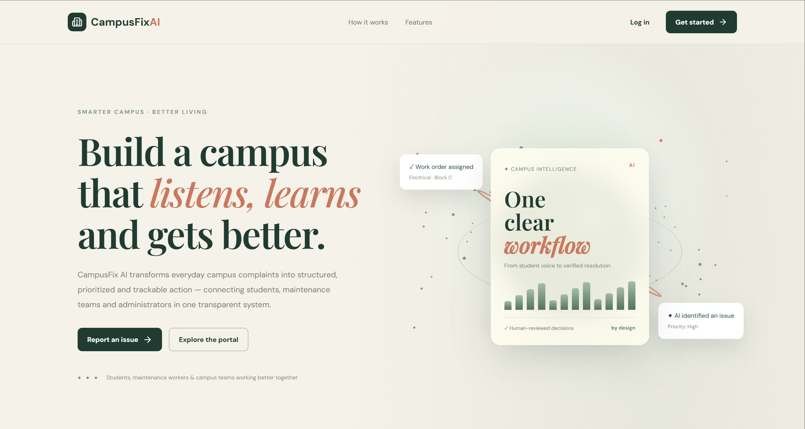
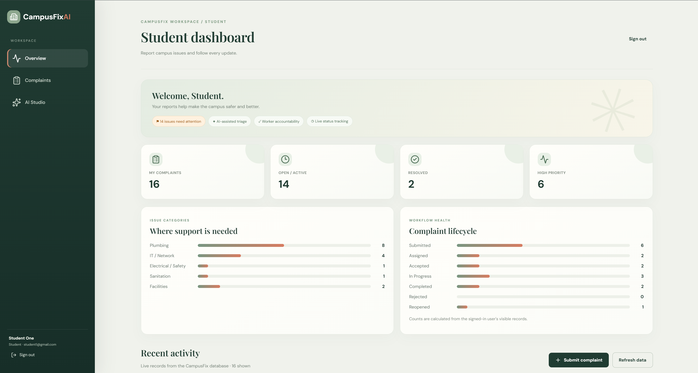
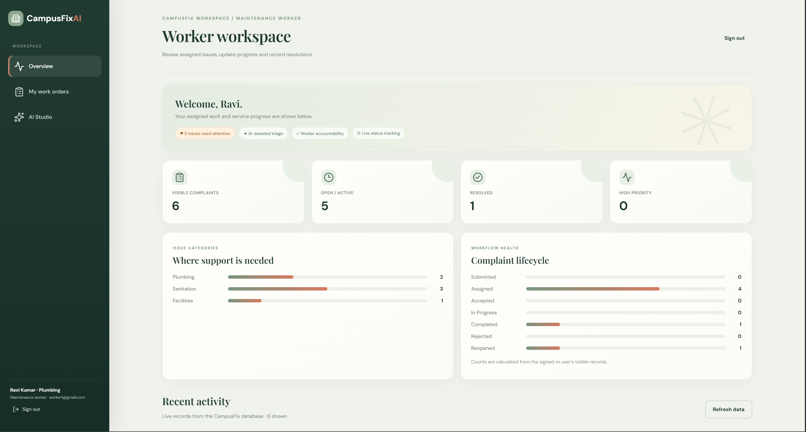
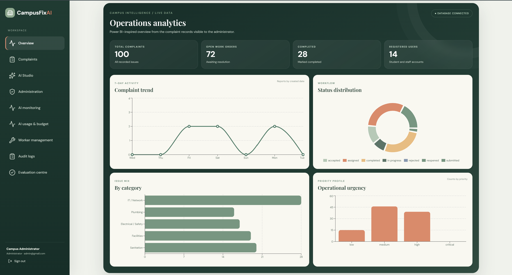
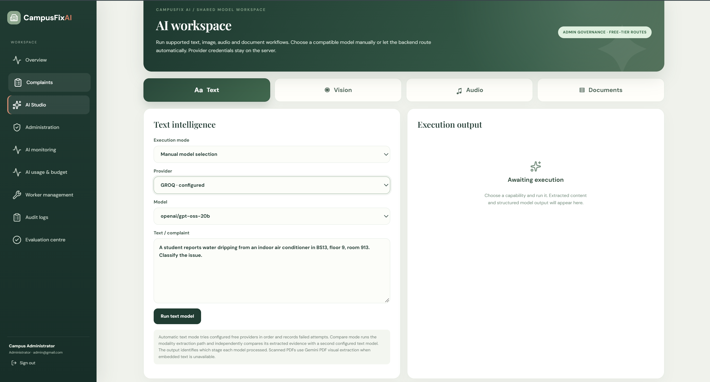
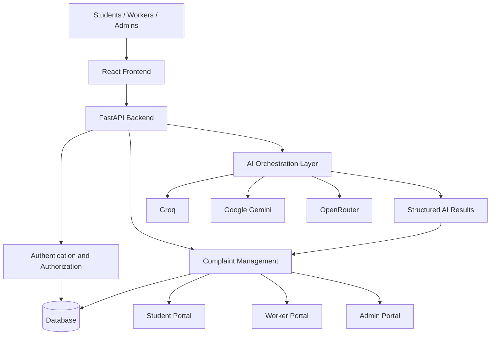
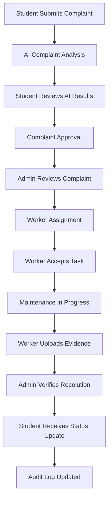

# CampusFix AI

### A Multimodal, Multi-Model Intelligent Campus Complaint Detection, Verification and Resolution System

<p align="center">
  <strong>Transforming Campus Maintenance Through Artificial Intelligence</strong>
</p>

<p align="center">
  
  
  
  
  
  
  
  
</p>

---

## 🖥️ Landing Page



---

## 📌 Project Information

**CampusFix AI** is an AI-powered campus maintenance complaint management platform designed to modernize how students report infrastructure and facility-related problems.

Traditional campus maintenance processes often involve manual complaint reporting, delayed communication, inefficient task assignment and limited visibility into resolution progress.

CampusFix AI addresses these challenges through multimodal artificial intelligence, intelligent complaint classification, role-based access control and a structured complaint resolution workflow.

Students can submit complaints through text, images, audio recordings and PDF documents. AI models analyze the submitted information, identify potential maintenance issues and generate structured recommendations to assist complaint handling.

The platform provides three dedicated role-based portals:

- **Student Portal:** Submit complaints, review AI analysis and track resolution progress.
- **Maintenance Worker Portal:** Receive assignments, manage maintenance tasks and upload completion evidence.
- **Admin Portal:** Manage complaints, assign workers, verify resolutions and monitor campus maintenance operations.

The system combines AI-assisted decision-making with human approval and verification to promote transparency, accountability and efficient campus maintenance.

---

## 📸 Application Screenshots

### 1. Student Dashboard

The student portal provides a centralized interface for submitting complaints, monitoring complaint status, reviewing previous requests and receiving updates.



### 2. Maintenance Worker Dashboard

The maintenance worker portal helps staff manage assigned tasks, update maintenance progress, add resolution notes and submit completion evidence.



### 3. Admin Dashboard

The administrator portal provides an overview of campus maintenance operations, complaint statistics, worker management, complaint assignments and resolution verification.



### 4. Multimodal AI Dashboard

The multimodal interface enables users to submit complaints through different input formats and access supported AI analysis capabilities.

Supported modalities:

- Text-based complaint analysis
- Image-based visual analysis
- Audio transcription and analysis
- PDF document extraction and analysis

The interface also supports AI model selection and comparison where configured.



---

## ✨ Key Features

### 🤖 1. Multimodal Complaint Understanding

CampusFix AI supports multiple complaint submission formats.

| Modality | Description |
|---|---|
| Text | Understands written maintenance complaints |
| Image | Analyzes uploaded images for visible infrastructure problems |
| Audio | Processes voice recordings through speech transcription and complaint analysis |
| PDF | Extracts relevant information from uploaded complaint documents |

### 🧠 2. Multi-Model AI Integration

The application integrates multiple AI providers to support model selection, analysis and comparison.

**Supported providers:**

- Groq
- Google Gemini
- OpenRouter

The application is designed to use available free-tier model routes, with provider quota handling and deterministic fallback behavior where configured.

### 📊 3. Intelligent Complaint Classification

AI-assisted analysis can generate structured complaint information, including:

- Complaint title and summary
- Complaint category
- Priority level
- Recommended department
- Relevant evidence
- Missing information
- Confidence information

### 👨‍🎓 4. Student Portal

- Submit campus maintenance complaints.
- Upload images, audio and PDF documents.
- Review AI-generated complaint information.
- Edit and approve complaint details.
- Track complaint progress.
- View complaint history.
- Receive status updates and notifications.

### 🛠️ 5. Maintenance Worker Portal

- View assigned maintenance complaints.
- Accept or reject assignments.
- Update task progress.
- Add maintenance notes.
- Upload resolution evidence.
- Track pending and completed tasks.

### 🛡️ 6. Admin Portal

- Monitor campus maintenance activities.
- View complaint statistics and analytics.
- Manage students and maintenance workers.
- Assign complaints to maintenance staff.
- Review AI-generated analysis.
- Verify resolution evidence.
- Monitor complaint status.
- Review audit logs and workflow activities.

### 🔍 7. Human-in-the-Loop Verification

AI-generated recommendations support decision-making rather than independently authorizing every important operation.

The workflow incorporates student approval, administrator verification and role-based authorization.

### 📋 8. Complaint Tracking and Audit Logs

The application maintains complaint progress and records relevant workflow activities to improve transparency, accountability and traceability.

---

## 🏗️ System Architecture

CampusFix AI follows a frontend-backend architecture with an AI integration layer and database persistence.



### Complaint Resolution Workflow



---

## 🧰 Technology Stack

| Layer | Technologies |
|---|---|
| Frontend | React, TypeScript |
| Build Tool | Vite |
| Styling | CSS, Tailwind CSS |
| Backend | Python, FastAPI |
| Database | SQLite for local development; PostgreSQL-compatible production configuration |
| ORM | SQLAlchemy |
| AI Providers | Groq, Google Gemini, OpenRouter |
| Authentication | Token-based authentication |
| API Documentation | FastAPI / Swagger UI |
| Version Control | Git, GitHub |
| Frontend Hosting | Vercel |
| Backend Hosting | Render |

---

## 📂 Project Structure

```text
CampusFix-AI/
│
├── backend/
│   ├── app/
│   │   ├── main.py
│   │   ├── database.py
│   │   ├── models/
│   │   ├── routes/
│   │   ├── services/
│   │   └── ...
│   │
│   ├── seed_synthetic_data.py
│   ├── requirements.txt
│   └── ...
│
├── frontend/
│   ├── src/
│   │   ├── components/
│   │   ├── pages/
│   │   ├── services/
│   │   ├── App.tsx
│   │   └── ...
│   │
│   ├── public/
│   ├── package.json
│   └── ...
│
├── docs/
│   └── screenshots/
│       ├── 01-landing-page.png
│       ├── 02-student-dashboard.png
│       ├── 03-worker-dashboard.png
│       ├── 04-admin-dashboard.png
│       └── 05-multimodal-dashboard.png
│
├── README.md
└── ...
```

*This is an illustrative structure. Keep the actual directory names and files from your repository if they differ.*

---

## ⚙️ Installation and Local Setup

### Prerequisites

Install the following software:

- Python 3.10 or later
- Node.js and npm
- Git
- VS Code or another code editor

### 1. Clone the Repository

```bash
git clone https://github.com/Lakshith-P/CampusFix-AI.git

cd CampusFix-AI
```

### 2. Backend Setup

Navigate to the backend directory:

```bash
cd backend
```

Create a Python virtual environment:

```bash
python -m venv venv
```

Activate it on Windows PowerShell:

```powershell
.\venv\Scripts\Activate.ps1
```

Install the dependencies:

```bash
pip install -r requirements.txt
```

### 3. Configure Backend Environment Variables

Create a `.env` file inside the backend directory.

```env
DATABASE_URL=sqlite:///./campusfix.db

GROQ_API_KEY=your_groq_api_key
GEMINI_API_KEY=your_gemini_api_key
OPENROUTER_API_KEY=your_openrouter_api_key
```

Add any additional environment variables required by your current backend configuration.

**Security note:** Never upload `.env` files, API keys, passwords or authentication secrets to GitHub. Keep provider credentials on the backend.

### 4. Start the Backend

Run:

```bash
uvicorn app.main:app --reload
```

Backend URL:

```text
http://127.0.0.1:8000
```

API documentation:

```text
http://127.0.0.1:8000/docs
```

Health check:

```text
http://127.0.0.1:8000/health
```

### 5. Frontend Setup

Open another terminal and navigate to the frontend directory:

```bash
cd frontend
```

Install frontend dependencies:

```bash
npm install
```

Create a `.env` file inside the frontend directory:

```env
VITE_API_URL=http://127.0.0.1:8000
```

Start the frontend:

```bash
npm run dev
```

Frontend URL:

```text
http://localhost:5173
```

---

## 🔐 AI Provider Configuration

CampusFix AI integrates multiple AI providers through backend services.

| Provider | Purpose |
|---|---|
| Groq | AI inference and supported audio processing |
| Google Gemini | Multimodal analysis and document understanding |
| OpenRouter | Access to supported model routes |

Configure API credentials through backend environment variables.

Provider availability, supported models and request limits depend on the selected models and their current provider quotas.

Never expose provider credentials in frontend code or public repositories.

---

## 🚀 Deployment

### Frontend Deployment — Vercel

The React frontend can be deployed using Vercel.

Recommended configuration:

| Setting | Value |
|---|---|
| Framework | Vite |
| Root Directory | `frontend` |
| Build Command | `npm run build` |
| Output Directory | `dist` |

Configure the frontend environment variable:

```env
VITE_API_URL=https://your-backend-url.onrender.com
```

Ensure the backend CORS configuration allows requests from the deployed frontend domain.

### Backend Deployment — Render

Deploy the FastAPI backend as a Render Web Service.

Recommended configuration:

| Setting | Value |
|---|---|
| Runtime | Python |
| Root Directory | `backend` |
| Build Command | `pip install -r requirements.txt` |
| Start Command | `uvicorn app.main:app --host 0.0.0.0 --port $PORT` |

Configure the required backend environment variables through the Render dashboard.

**Production database:** Local SQLite and production database configurations should be managed separately. SQLite on an ephemeral Render filesystem is not suitable for persistent production data. Use persistent storage or a managed database for production.

---

## 🧪 Testing and Evaluation

The application can be evaluated across the following areas:

| Test Area | Evaluation Objective |
|---|---|
| Text Complaint | Verify complaint understanding |
| Image Analysis | Identify visible maintenance problems |
| Audio Processing | Verify transcription and complaint analysis |
| PDF Extraction | Extract relevant information from documents |
| Model Comparison | Compare supported model outputs |
| Complaint Classification | Evaluate category and priority recommendations |
| Authorization | Verify role-based access |
| Complaint Assignment | Verify administrator-to-worker assignment |
| Resolution Verification | Verify evidence and administrator approval |
| Audit Logging | Verify workflow activity records |

Testing should be documented with actual inputs, expected outputs, observed results and supporting evidence.

---

## 🔒 Security and Reliability

The system incorporates the following security considerations:

- Backend-only AI provider credentials.
- Authentication for protected operations.
- Role-based access control.
- Input validation and structured AI responses.
- Human approval for important workflow decisions.
- Audit logging for relevant activities.
- Provider error and quota handling.

---

## 🎯 Project Objectives

1. Simplify campus maintenance complaint submission.
2. Enable multimodal complaint understanding.
3. Improve complaint classification and prioritization.
4. Support efficient maintenance task assignment.
5. Introduce AI-assisted verification and human oversight.
6. Improve campus maintenance transparency through complaint tracking and audit logs.

---

## 🔮 Future Enhancements

- Real-time notifications and communication.
- Advanced campus maintenance analytics.
- Improved multimodal model evaluation.
- Automated SLA monitoring and escalation.
- Mobile-friendly complaint reporting.
- Enhanced AI evaluation and observability.
- Additional campus infrastructure integrations.

---

## 👨‍💻 Project Information

| Field | Details |
|---|---|
| Project Name | CampusFix AI |
| Project Category | Generative AI / Full-Stack Application / Smart Campus |
| Frontend | React + TypeScript + Vite |
| Backend | Python + FastAPI |
| AI Integration | Groq, Gemini, OpenRouter |
| Repository | [CampusFix-AI](https://github.com/Lakshith-P/CampusFix-AI) |
| Frontend Hosting | Vercel |
| Backend Hosting | Render |

---

## 📄 License

This project is developed for academic and educational purposes. Add an appropriate open-source license if you intend to distribute the project under specific reuse terms.

---

<p align="center">
  <strong>CampusFix AI</strong>
  <br />
  Smarter Campus. Faster Resolution. Better Experience.
</p>
