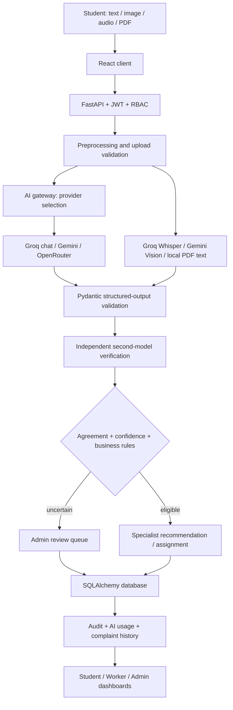

# CampusFix AI architecture

## Role responsibilities

- **Student:** create a complaint, provide block/building and optional floor/room/landmark, view own complaint and history, reopen a completed complaint.
- **Maintenance worker:** view assigned work, accept/start/complete work, add a resolution note. Internal backend role is `staff`; the product label is Maintenance Worker.
- **Admin:** view campus-wide records, assign/reassign specialists, inspect AI usage and audit history, manage roles.

## AI model routing

- Text triage: Groq chat (configured open-weight model) → Gemini → optional OpenRouter free route.
- Audio: Groq Whisper transcription.
- Image: Gemini vision description.
- PDF: local `pypdf` extraction for embedded text. Scanned PDFs need OCR; no OCR provider is silently invoked.
- Verification: first configured provider different from the primary. If none is available, verification is unavailable and the complaint is marked for human review.
- Fallback: local TF-IDF/logistic regression trained on the included small synthetic training CSV, then keyword rules. The local model is a demo baseline, not production-quality campus intelligence.

## Important design boundary

The model recommends a category, priority and department. The backend alone enforces user permissions, duplicate rules, budget limits, allowed status values, worker assignment and resolution requirements. AI never confirms that physical maintenance work happened.
